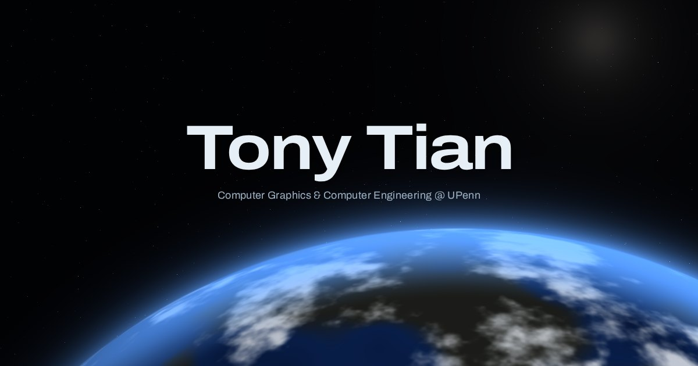
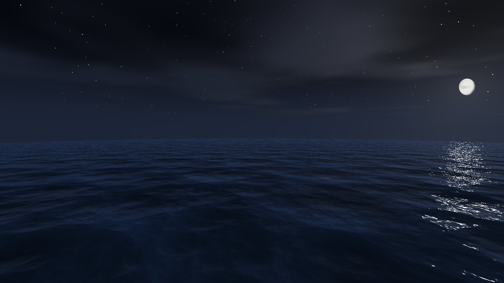
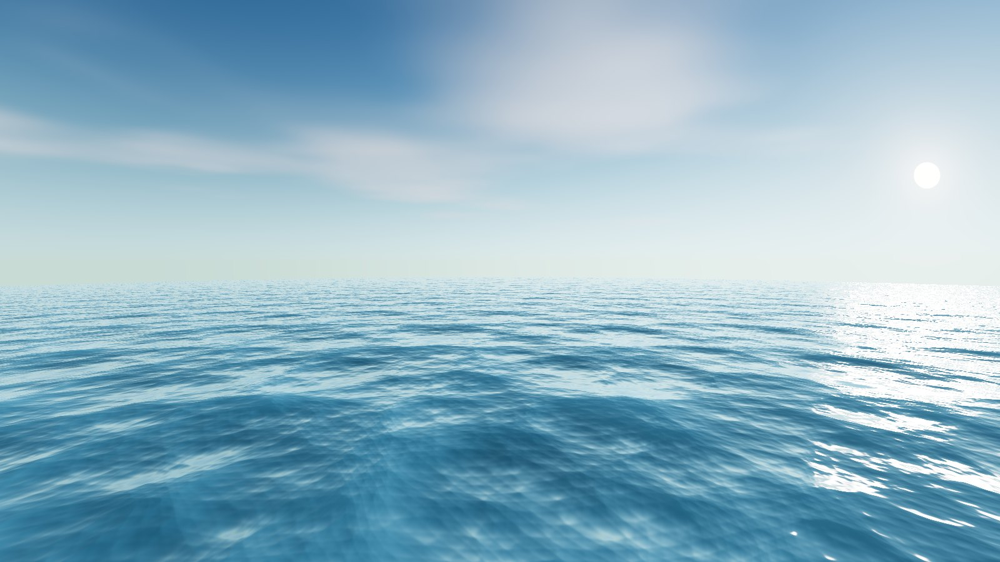

# tonyxtian.com



Personal website and portfolio of **Tony Yiding Tian**, a graphics engineer at the University of
Pennsylvania, live at **[tonyxtian.com](https://tonyxtian.com)**.

This site is also a rendering project in its own right. Behind every page, one
full-screen GLSL fragment shader draws a world live on WebGL 2: space, a planet
and its clouds, an ocean, and the sky by night and by day. There are no textures
and no models; all of it is procedural.

The layout is inspired by GPU frame debuggers. There is an address list of every
project, a viewport showing one at a time with its measured results, and a
timeline of when each was made.

- [The site](#the-site)
- [How it renders](#how-it-renders)
- [How it's built](#how-its-built)
- [Project structure](#project-structure)
- [Running it](#running-it)
- [Adding content](#adding-content)
- [Deployment](#deployment)
- [Credits and license](#credits-and-license)

---

## The site

**The home page opens in space.** Scrolling plays a descent from orbit, through
the clouds, down to the sea the site sits on. A link straight to a project
starts on the sea.

**The layout.**
- **Top bar.** Shows the renderer's own numbers, measured live: frame time, pixel ratio, and waves per pixel.
- **ADDR panel.** Lists every location under a hex address: the intro and About at `0x00` and `0x01`, each group of projects on its own high digit (`0x10` production, `0x2x` rendering, `0x3x` games and XR), and Contact at `0xFF`.
- **Stage.** Shows one project at a time, in a viewport frame with its results beside it.
- **Bottom bar.** Holds a timeline of every project from 2024 to 2026, the day/night switch and the email address.

**One step per gesture.** A scroll, a swipe or an arrow key moves exactly one
project, however long a trackpad's momentum runs. Each project opens into a case
study with its own address, such as [`/matforge/`](https://tonyxtian.com/matforge/).

**The last stop, Contact, is the finale.** The camera looks up from the sea to
the horizon as night falls, with the moon over the water. In the light theme the
sun is there instead.

<p>
  
  
</p>

### Controls

| | Desktop | Phone |
|---|---|---|
| Next / previous project | Scroll, <kbd>↓</kbd> <kbd>↑</kbd>, <kbd>j</kbd> <kbd>k</kbd>, <kbd>Space</kbd> | Swipe up / down or left / right, or the ↑ ↓ buttons |
| Jump anywhere | A row in ADDR, or a bar in the timeline; <kbd>Home</kbd> <kbd>End</kbd> | **Addr** opens the list as a sheet |
| Open a case study | <kbd>Enter</kbd>, **More**, or the selected row again | **More** |
| Previous / next case study | <kbd>←</kbd> <kbd>→</kbd> | The arrows at the top of the case study |
| Close it | <kbd>Esc</kbd>, ✕, or the browser's back button | ✕ or back |
| Back to the intro | **Intro**, scrolling up from About, or the name in the top bar | Swipe down on About |
| Play the descent | Scroll or <kbd>↓</kbd>; <kbd>Enter</kbd> or <kbd>Esc</kbd> to fast-forward | Drag up |
| Day or night | The switch in the bottom bar | The same |

---

## How it renders

The world is one fragment shader on a screen-sized quad
([`background-frag.glsl`](src/engine/shaders/background-frag.glsl)). A comet is
drawn over it with additive blending. Three scenes share the shader, and each is
worked out only while it can be seen.

### From orbit to the sea


- **The planet.** A single circle far larger than the screen, its centre well below it. Only a shallow arc of the limb is ever in view, so it reads as something enormous seen from orbit. It's shaded as a sphere: continents and clouds come from value-noise fbm on its surface, with a wrapped diffuse terminator and an atmospheric halo on the sunlit limb.
- **The descent.** It's a timeline driven by scroll ([`Descent.ts`](src/engine/Descent.ts)).
  - The camera pans onto the planet and falls. Altitude drops geometrically, so the magnification multiplies at an even rate rather than lurching at the end.
  - The clouds sit nearer the camera than the ground, so they magnify faster. That parallax is what makes the zoom read as a fall rather than a picture being enlarged.
  - The clouds swell past the edges of the screen and thin away as the camera drops through them.
- **Detail that keeps up.** Every doubling of the zoom adds a noise octave, and the newest octave fades in by its fraction, so detail never pops in. The sea level rises during the fall, so the camera always comes down over open water.

### The ocean

The sea is adapted from afl_ext's MIT-licensed
[Very fast procedural ocean](https://www.shadertoy.com/view/MdXyzX): peaked
`exp(sin)` waves, each dragging the water along for the next, which bunches
the crests together the way real ones are.

- **One pass.** The original raymarches the surface and differences its height to get the normal. Here the view ray meets the water directly, and the slope is summed alongside the height in the same loop. That is **24 wave evaluations a pixel instead of hundreds**.
- **A curved horizon.** The water is a sphere the planet's size (radius 4000), and the ray is intersected with it. Looking down behind the content the curve doesn't show; looking out at the finale it bends the horizon.
- **No shimmer.** Normals flatten with distance, so the far sea doesn't fizz with detail finer than its pixels.
- **Shading.** Fresnel reflection of the sky, a glint from the sun or moon, and light scattered up through the crests, finished with an ACES tonemap.

### Night, day and the wheel of sky

- **The finale.** At Contact the camera springs up from looking straight down to the horizon on a critically damped spring. It sets off alongside the camera's glide over the sea, so it never pauses.
- **Night falls first.** Night has to complete before any sky comes into view, or the day sky would show above the curved horizon. So its timing is worked out from the camera's own geometry: the view is ±34° vertically, and its top clears the horizon only after night is done (0.45 s, against 0.53 to 0.6 s on any screen shape). On the way back, night waits until the sky is out of view before it lifts.
- **The moon.** It's shaded as a sphere in screen space, so it stays round at the edge of a wide view: dark seas and crater grain from noise on the sphere, a soft terminator, and a darkened rim. Its glint on the water is its own disc mirrored in the waves that catch it, which lays the narrow path of light a real moon does.
- **The wheel of sky.** The sun and the moon ride opposite ends of one wheel, turning about the view's axis. Switching to day turns it half round, clockwise: the moon sets on the right as the sun rises on the left, arcs over the top and settles in the moon's place. It only ever turns that way. Back to night is the second half of the circle: the sun sets on the right as the moon comes up on the left. The switch's own icon is the same wheel in miniature and turns with it.

### The comet

In space, a comet circles the cursor ([`Comet.ts`](src/engine/Comet.ts)):

- **Orbit.** It follows a precessing **Kepler orbit**, solved from Kepler's equation each frame, so it speeds up near the cursor and slows far from it. The orbit itself turns a little each lap.
- **Following the cursor.** It orbits an anchor that follows the cursor as a critically damped spring.
- **Tail.** It's a deformed icosphere: it stretches and narrows with speed and bends with the path's curvature, clamped so a sudden jerk can't snap it into a hook.

### Frame budget

- **Resolution.** The sea behind the content is drawn at **0.75 pixels per CSS pixel**, whatever the screen's density; it's soft enough to lose nothing by it. Full resolution, capped at 1.5, comes back only for the descent and for the finale's horizon, stars and moon.
- **Only what's visible.** Each scene runs only while it shows. Once the sea has taken over, the planet and its clouds cost nothing.
- **Live numbers.** The top bar shows the renderer's own figures: the mean time between frames over the last quarter second, the current pixel ratio, and the wave count, which is read from the shader source so it can't drift from what's drawn.

---

## How it's built

[Vite](https://vite.dev), [React 19](https://react.dev) and TypeScript in
strict mode, plain CSS, and [gl-matrix](https://glmatrix.net). The whole site is
about 137 KB of gzipped JavaScript, React and every case study included, and
7 KB of CSS.

### Engine and app

The renderer in [`src/engine/`](src/engine) is plain TypeScript with no React in
it. The app steers it only through a few numbers, and the frame loop eases
toward them, so React never has to render per frame:

```
input/ (wheel, keys, touch) ─► actions.ts ─► store.ts ─► ui/ (React)
                                   │
                                   └─► engine.targets { descent, finale, travel, day }
                                              │
                                              ▼
                                   engine.ts frame loop ─► shaders
                                              │
             onLanded, onFinaleClear, onStats; --descent and --finale on <html>
```

- **The targets.** The descent eases toward its target; the finale and the glide over the sea are critically damped springs; nightfall and the day/night turn are timed ramps.
- **Talking back.** The engine reports landing, the camera's return from Contact, and its frame stats through callbacks. It also writes two CSS variables every frame, so the page fades its own pieces in step with the camera with no React involved: the intro, the panels during the descent, and the Contact card.

### Input

A trackpad flick sends events for a second or more as its momentum dies away.
[`wheel.ts`](src/input/wheel.ts) turns each gesture into exactly one step:

- **When a gesture ends.** It ends after 240 ms of quiet, and steps once it has moved 24 px.
- **A fresh flick.** Momentum only ever fades. So events that grow, twice running or by a single large jump, are a new flick laid over the old one's tail.
- **Mouse wheels.** A wheel with notches is recognised by the pause between its clicks.
- **After the descent.** When the descent lands mid-scroll, the rest of that gesture is swallowed, so its momentum doesn't run on into the site.

### Routes and prerendering

- **Addresses.** `/` is home, and `/about/` and `/<project>/` open case studies.
- **The prerender.** [`scripts/prerender.ts`](scripts/prerender.ts) runs after `vite build` and writes an `index.html` for every route. Each gets its own title, description, canonical URL and share card, plus a plain-HTML version of its content for crawlers and visitors without script.
- **Extra files.** It also writes `sitemap.xml`, and fails the build if a picture named in the content is missing.
- **Opening a case study.** It pushes its address. The back button closes it, and a deep link opens straight onto it, without the descent.

### Themes

- **Two themes.** Dark ("night") is the site's own. Light ("day") switches the panels to light frosted glass.
- **Fading.** Every colour is a CSS custom property registered with `@property`, so a switch fades the page in step with the sky's turn. It's timed to the middle of it, when the sea brightens or darkens.
- **No flash.** The choice is remembered, and applied before the first paint.

### Accessibility

- **Keyboard.** Everything works from the keyboard.
- **Screen readers.** A live region announces each step, and the case study is a labelled dialog that takes focus and gives it back.
- **Reduced motion.** It skips the descent and makes the day/night turn instant.
- **Without WebGL.** The site keeps a CSS background and drops the intro.
- **Without script.** Every route is still a readable page.

---

## Project structure

```
index.html              the page template: meta tags, fonts, icons, theme before paint
src/
  main.tsx              boots the engine, the input handlers and React
  actions.ts            every change of state, and the only code that steers the engine
  store.ts              the small app state, read with useSyncExternalStore
  routing.ts            addresses: /, /about/, /<project>/
  media.ts              every file in src/media/ by name, as its hashed URL
  engine/
    engine.ts           createEngine(canvas): the frame loop, springs and targets
    Descent.ts          the landing timeline
    Comet.ts            the comet's orbit
    shaders/            background-frag.glsl (the world), lambert-*.glsl (the comet)
    rendering/gl/       WebGL wrappers from the CIS 566 base code
    geometry/
  input/
    wheel.ts            one step per wheel or trackpad gesture
    bind.ts             wheel, keys and touch
  content/
    types.ts            the content model
    entries.ts          every project, in order
    site.ts             names, links, About, Contact, the passes
  ui/                   React: App, TopBar, IndexList, Stage, Timeline, BottomBar,
                        CaseStudy, Intro, Sheet, DayNight, bits
  styles/app.css        the only stylesheet: tokens for both themes, then the layout
  media/                images and video; originals/ and drafts/ aren't shipped
scripts/prerender.ts    one HTML file per route, and the sitemap
public/robots.txt
deploy.sh               pull, build, sync dist/ to the web root
```

---

## Running it

You need Node 20 or later.

```bash
npm install
npm run dev        # http://localhost:5174
npm run build      # typecheck, vite build, then prerender every route into dist/
npm run preview    # serve dist/ at http://localhost:5175
npm run typecheck  # the app, then the Node-side scripts
```

---

## Adding content

All of the text is typed data in [`src/content/`](src/content). The About
section, the links and Contact are in `site.ts`. Every project is a
`WorkEntry` in `entries.ts`:

```ts
{
  kind: 'work',
  id: 'matforge',                 // also its address: /matforge/
  pass: 'rendering',              // production | rendering | interactive | systems
  title: 'MatForge',
  metric: '+2.57 dB',             // the ADDR column
  tagline: 'Four SIGGRAPH papers in one Vulkan path tracer',
  dates: 'Nov – Dec 2025',        // as shown
  span: ['2025-11', '2025-12'],   // for the timeline
  stack: ['Vulkan 1.3', 'Slang', 'C++'],
  counters: [{value: '+2.57 dB', label: 'PSNR over PCG sampling at 512 spp'}],
  hero: {src: 'matforge.jpg', width: 1600, height: 1041, alt: '…'},
  links: [{label: 'Project website', href: 'https://matforge.github.io/'}],
  blocks: [{kind: 'p', text: 'The case study, with **bold** allowed.'}],
}
```

- **Order.** Put projects in their pass, newest first. Addresses, groups, counts and the timeline follow from the order on their own.
- **Pictures.** Put them in `src/media/`, about 1600 px wide, and give their real size in `hero`. A clip is a WebM in `video`, with the image as its poster. A project without a picture is set as type alone.
- **Not shipped.** `draft: true` keeps an entry out of the site; drafts' images go in `src/media/drafts/`. Full-size sources go in `src/media/originals/`.
- **Counters.** They are measured results, two or three to a project.
- **The case study.** `blocks` is a list of paragraphs (`p`), headings (`h`), lists (`list`, numbered with `ordered: true`), pictures (`media`, with a caption), side-by-side pictures (`gallery`, each with its own label, stacked on a phone), tables (`table`) and code (`code`). Text can mark `**bold**` and `` `code` `` spans. A table column whose every cell starts with a number is set as figures, right-aligned. Each project's case study follows its README: what it does, how, and its measured results.

---

## Deployment

The site is served by nginx from `/var/www/tonyxtian.com`, behind Cloudflare.
[`deploy.sh`](deploy.sh) pulls, installs, builds, and syncs `dist/` to the web
root.

- **Serving routes.** nginx's `try_files $uri $uri/ =404` serves each route's prerendered `dist/<route>/index.html` as it is.
- **Caching.** Every asset has a content hash in its name, icons included, so Cloudflare can cache them for good while the HTML stays fresh.

---

## Credits and license

- **The ocean** is adapted from afl_ext's [Very fast procedural ocean](https://www.shadertoy.com/view/MdXyzX) (MIT). Its copyright and permission notice are kept in [`background-frag.glsl`](src/engine/shaders/background-frag.glsl).
- **The renderer** grew out of a fireball homework for CIS 566, Procedural Computer Graphics, at the University of Pennsylvania. Its WebGL wrapper classes come from the course's base code.
- **Icons:** the GitHub mark is from [Primer Octicons](https://primer.style/octicons) (MIT), and the LinkedIn mark from [Simple Icons](https://simpleicons.org) (CC0).
- **Type:** [Archivo](https://fonts.google.com/specimen/Archivo) and [JetBrains Mono](https://fonts.google.com/specimen/JetBrains+Mono), from Google Fonts (SIL Open Font License).
- **`LICENSE`** is the GPL-3.0 file from the Dopefolio template this repository was first forked from.
